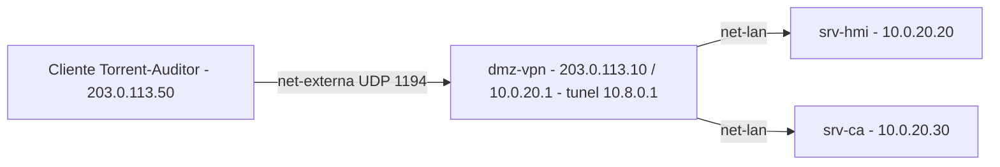

# Práctica 2 (v2) · Pasarela de acceso con OpenVPN y Easy-RSA

## Qué vas a construir

| Máquina |	Red net-externa | Red net-lan | Para qué sirve |
| --- | --- | --- | --- |
| srv-ca | 	|	10.0.20.30	| La CA de la VPN (Easy-RSA). Firma certificados y se apaga |
| dmz-vpn	| 203.0.113.10 | 10.0.20.1	| Pasarela OpenVPN y filtro entre las dos redes |
| srv-hmi | | 10.0.20.20	| El servicio que se quiere proteger (el de la Fase 0) |
| Cliente | 203.0.113.50 |	| El equipo del técnico externo | 

Red del túnel VPN: 10.8.0.0/24.

Regla de oro: ca.key no sale nunca de srv-ca, y ninguna clave privada sale de la máquina donde se generó.

### Antes de empezar
[ ] Las máquinas srv-ca, dmz-vpn y el cliente tienen salida a Internet por el adaptador de gestión, para instalar easy-rsa y openvpn (Parte 1).

[ ] Tienes una VM dmz-vpn (Ubuntu Server o Debian mínimo) y una VM cliente (puede ser Torrent-Auditor).

[ ] Todas las VM tienen la hora correcta. Un certificado «todavía no válido» por un reloj desfasado es el fallo más típico de esta práctica. Compruébalo con date en cada una.

Parte 0 · La red del laboratorio
0.1 Adaptadores en VirtualBox

Cada VM conserva el adaptador que ya usabas (NAT o solo anfitrión). Lo llamamos gestión: sirve para instalar paquetes y pasar ficheros. Añade estos adaptadores de tipo Red interna:

| VM	| Adaptador de red interna |
| --- | --- |
| dmz-vpn	| Uno en net-externa y otro en net-lan |
| srv-hmi	| Uno en net-lan |
| srv-ca	| Uno en net-lan |
| Cliente	| Uno en net-externa |

Los nombres de interfaz (enp0s3, enp0s8…) cambian de una máquina a otra. Averigua los tuyos con:

ip -br a

### 0.2 Direcciones IP
En cada máquina, pon la IP de la tabla en el adaptador que corresponda (sustituye IFACE por el nombre de tu interfaz):

sudo ip addr add 203.0.113.10/24 dev IFACE    # dmz-vpn, interfaz de net-externa

sudo ip addr add 10.0.20.1/24 dev IFACE       # dmz-vpn, interfaz de net-lan

sudo ip addr add 10.0.20.20/24 dev IFACE      # srv-hmi

sudo ip addr add 10.0.20.30/24 dev IFACE      # srv-ca

sudo ip addr add 203.0.113.50/24 dev IFACE    # cliente

sudo ip link set IFACE up

Estas direcciones se pierden al reiniciar. Para que persistan, añádelas a la configuración de red de tu distribución (netplan o /etc/network/interfaces).

Comprueba la conectividad dentro de cada red:

ping -c 2 203.0.113.10    # desde el cliente

ping -c 2 10.0.20.20      # desde dmz-vpn

### 0.3 Ruta de retorno en srv-hmi

Para que srv-hmi sepa cómo contestar a los clientes de la VPN, dile que la red 10.8.0.0/24 está detrás de la pasarela:

sudo ip route add 10.8.0.0/24 via 10.0.20.1

### 0.4 Antes de montar nada: sin VPN no se llega

Desconecta los adaptadores de gestión de todas las máquinas (en VirtualBox, desmarca «Cable conectado»). Si no lo haces, el cliente podría llegar al HMI por esa vía y la prueba no valdría.

Volverás a conectarlos solo para instalar paquetes y copiar ficheros (Partes 1, 2, 4 y 6.3). Antes de la Parte 5, déjalos desconectados otra vez.

Desde el cliente:

ping -c 2 10.0.20.20

- Entrega 0. Captura del ping fallando (sin ruta o sin respuesta) y de ip -br a en el cliente.

## Parte 1 · Montar la CA con Easy-RSA y emitir los certificados

En la UD3 montaste una CA a mano con openssl. Easy-RSA es un conjunto de scripts del propio proyecto OpenVPN que automatiza esos mismos comandos: tú indicas qué quieres (build-ca, gen-req, sign-req…) y él lanza por debajo los openssl necesarios, en la estructura de carpetas correcta y llevando el registro de todo lo emitido. Es la herramienta habitual para montar la PKI de una VPN.

### Qué hace Easy-RSA por debajo

Nada de lo que hace es nuevo para ti. Esta tabla relaciona cada orden con lo que hacías en la UD3:

