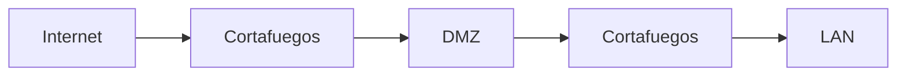

# Práctica 1 · Perímetro y zonas

## Minirreto 1: coloca cada servicio en su zona

#### Zonas disponibles
| Zona | Confianza | Idea |
| --- | --- | --- |
| Internet |No confiable | Cualquiera, sin control |
| DMZ | Semiconfiable | Servicios expuestos a Internet, aislados de la LAN |
| LAN	| Confiable	| Usuarios y equipos propios |
| Zona crítica | Restringida | Activos de alto valor con pocos accesos |

Si un servicio no encaja en ninguna, créale una zona propia y defiende por qué.

#### Servicios de Torrent
1- Web corporativa pública
2- Servidor de correo
3- Pasarela VPN
4- Proxy (saliente e inverso)
5- HMI de planta y carpeta de planos
6- Autoridad de certificación (srv-ca)
7- Servidor de copias de seguridad
8- Portátiles de ingenieros y operarios
9- Wi-Fi de invitados
10- Servidor de registros y monitorización

### Qué tienes que entregar
1. Tabla de ubicación. Una fila por servicio:

| Servicio | Zona |	Justificación (una frase) |
| --- | --- | --- |
| Web corporativa |	…	| … |

Para decidir, responde mentalmente a estas cuatro preguntas:

¿Necesita Internet?

¿Qué pasa si cae?

¿Qué datos maneja?

¿Quién necesita llegar a él?

2. Tabla de flujos. Qué conexiones se permiten y cuáles no entre zonas:

| Origen → destino | ¿Permitido? | Ejemplo concreto |
| --- | --- | --- |
| Internet → DMZ	| …	| … |
| Internet → LAN	| …	| … |
| DMZ → LAN	| …	| … |
| LAN → DMZ	| …	| … |
| LAN → Internet	| …	| … |
3. Un diagrama de la red. Puedes dibujarlo con el bloque de Mermaid de abajo (GitHub lo muestra solo) o subir una imagen.

4. Una pregunta de reflexión (3 o 4 líneas): si cae el servidor web, ¿qué puede hacer el atacante en tu diseño y qué se lo impide?

